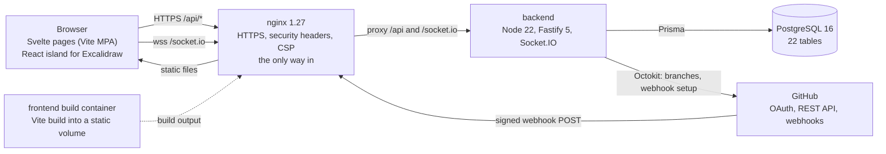
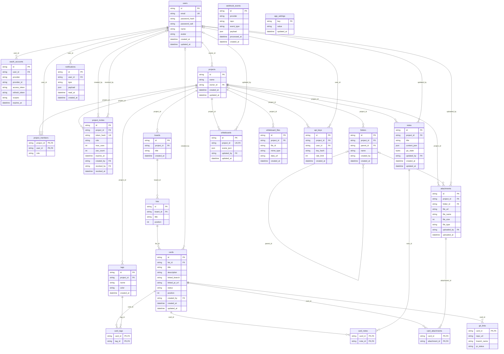

*This project has been created as part of the 42 curriculum by esergeev, bfourmy, lulmaruy, xzhen, mpareau.*

# Transcendance

A shared workspace for a team: a Kanban board, a whiteboard, live notes and files in one project. The board follows your Git branches on its own.

## Contents

- [Description](#description)
- [Instructions](#instructions)
- [Team information](#team-information)
- [Project management](#project-management)
- [Technical stack](#technical-stack)
- [Architecture](#architecture)
- [Database schema](#database-schema)
- [Features list](#features-list)
- [Modules](#modules)
- [Individual contributions](#individual-contributions)
- [Resources](#resources)
- [Known limitations](#known-limitations)

## Description

**Goal.** Give a team one place to plan work, draw ideas and write together, instead of three tools that do not talk to each other. Git drives the board, so it stays up to date without effort.

**What you can do**

- Create projects and invite people. Each person has a role: viewer, member or admin.
- Use a Kanban board with lists, cards and tags. Changes appear live on everyone's screen.
- Link a card to a GitHub branch. The card moves when a pull request is opened and when it is merged.
- Draw on a whiteboard and write notes together, at the same time.
- Store files in folders and attach them to cards.
- Get notifications and search cards, notes and files.
- Use a public REST API with API keys.
- Sign up with an email and a password. GitHub can be linked to an account later, to log in with it.

The interface is in French. This README and the code are in English.

## Instructions

### What you need

- Docker with the Compose plugin (or Podman with a `docker` command)
- Bash and OpenSSL
- Free ports 8080 and 8443 (you can change them)

Everything else (Node.js, PostgreSQL, dependencies) runs in the containers.

### Start the project

```bash
git clone <repository-url> && cd ft_transcendence
./transcendence start
```

The first time, the script asks a few questions and writes the answers in `.env`. You never need to edit `.env` by hand. Press Enter to keep the default of each question.

- Mode: `dev` (local work) or `prod` (strict checks, for a real server)
- HTTP and HTTPS ports
- Public address of the app (leave empty on a local machine)
- Your own TLS certificate and key (leave empty for a self-signed one)
- Password of the admin page that opens and closes sign-ups (leave empty to get a random one, shown once)
- GitHub OAuth id and secret (leave empty if you do not need GitHub)

Then open:

- https://localhost:8443/ : the app (accept the browser warning if the certificate is self-signed)
- https://localhost:8443/api/health : should say `"status":"ok"`
- https://localhost:8443/api-docs : documentation of the public API
- https://localhost:8443/api/admin/signup : open or close sign-ups (needs the admin password)

A plain `docker compose up` is not enough on a fresh clone: the script is what creates `.env`, the encryption key and the TLS certificate.

### Other commands

| Command | What it does |
|---|---|
| `./transcendence stop` | Stop the containers (data is kept) |
| `./transcendence restart` | Stop, then start again |
| `./transcendence reload` | Rebuild only the frontend |
| `./transcendence setup` | Answer the setup questions again |
| `./transcendence oauth` | Enter the GitHub credentials again |
| `./transcendence clear` | Delete the containers and all the data |
| `./transcendence clean` | Delete build leftovers |

More details are in [docs/deployment.md](docs/deployment.md).

### GitHub login

Create an OAuth App on <https://github.com/settings/developers>. Its callback URL is shown by `./transcendence start`. Then give the id and secret to `./transcendence oauth`.

GitHub never creates an account. First sign up with an email, then go to Settings and click "Link my GitHub account". After that, "Log in with GitHub" works for this account, even if the GitHub email is different.

### Tests

```bash
cd backend && npm ci && npm test
```

The 13 end-to-end suites run against the real app and a temporary PostgreSQL started in Docker. Your data is not touched.

## Team information

| Member | Role | Responsibilities |
|---|---|---|
| lulmaruy | Technical Lead, Developer | Foundation: accounts, login, GitHub OAuth, projects, members, permissions, public API, database, Docker and nginx |
| bfourmy | Product Owner, Developer | Kanban backend (lists, cards, tags), real-time layer (WebSockets), project documentation |
| esergeev | Developer | Git integration: branches, pull requests, webhooks |
| xzhen | Project Manager, Developer | Whiteboard, notes, search, notifications, file upload, legal pages |
| mpareau | Developer | Interface: landing page, dashboard, Kanban screens, files page, design system, start script, multi languages |

## Project management

- **Task distribution.** The work was split into four tracks, written down in [`docs/github-workflow.md`](docs/github-workflow.md) as directory ownership, so every pull request had an obvious reviewer and merge conflicts stayed rare: foundation and API, Kanban and real time, Git integration, and whiteboard / notes / files.
- **Meetings.** The team synced regularly over the project, and read through the whole code base together before submission.
- **Communication channels.** **Discord** for day-to-day discussion, and **GitHub** for everything that touches the code — pull requests, reviews and comments.
- **Tools and review rule.** GitHub pull requests were the tracking tool. Every new feature goes on its own branch and into its own pull request, and **a pull request is merged only after at least one other member has reviewed it and tested it**, into `dev` first and then `main`. Anything touching the shared infrastructure (`infra/`, `docker-compose.yml`, `.env.example`) needed a second reviewer, because breaking it blocks everyone. Progress was tracked in `TODO.md` and in [`docs/ft_transcendence_plan.md`](docs/ft_transcendence_plan.md).
- **Quality.** 13 end-to-end suites run against the real application, so a change can be checked quickly.

## Technical stack

| Part | Choice | Why |
|---|---|---|
| Backend | Fastify (Node.js 22, TypeScript) | Fast, typed, with plugins for security headers, rate limits and uploads |
| Real time | Socket.IO | Rooms per project and automatic reconnection |
| Database | PostgreSQL 16 with Prisma | Typed queries, migrations, safe transactions |
| Frontend | Svelte 5 with Vite | Light and reactive, good for live boards |
| Whiteboard | Excalidraw | Ready-made drawing tool |
| Notes | Tiptap and Yjs | Several people can type together without conflicts |
| Git | Octokit and signed webhooks | Official GitHub client |
| Login | Salted password hashes, JWT, GitHub OAuth 2.0 | Standard and well known |
| Styling | Our own design system: CSS custom properties and Svelte scoped styles | No framework to fight with, and the styles cannot leak between components |
| Hosting | Docker Compose and nginx (HTTPS) | One command starts everything |

**Why these choices.**

- **Fastify** is a real framework, not a bare HTTP layer: one plugin per module with its own encapsulation, a routing system, hook chains (`requireAuth`, then `requireRole`, run before any handler), and JSON-schema validation. We preferred it to Express for typed requests and built-in validation, and to NestJS because we did not need dependency injection on top.
- **TypeScript end to end** (strict mode), so the database types, the API and the interface share one set of types.
- **PostgreSQL with Prisma** gives a typed schema with explicit relations, versioned migrations applied at start-up, and transactions whose isolation level we control. There is **no raw SQL anywhere** in the backend.
- **Svelte** because the board has drag and drop, live updates coming from other people and a read-only mode per role — too much state to keep consistent in hand-written DOM code. It is a multi-page application: every screen is a Vite entry and nginx maps the clean URLs to them, so there is no client-side router.
- **React only where it is imposed**: Excalidraw ships as a React component, so the whiteboard page mounts a small React island. Nothing else uses React.
- **Yjs** for the notes, because several people typing in the same paragraph needs a structure that merges, not a "last save wins".
- **Docker Compose and nginx**: one command starts everything, and nginx is the only way in — HTTPS, security headers, a strict Content-Security-Policy, and the proxy for `/api/` and `/socket.io/`.

All connections from a browser or a script use HTTPS (`http://` answers a 308 redirect, WebSockets are `wss://`). The containers talk to each other on a private Docker network that is never published on the host, which the subject allows.

## Architecture



Everything runs in Docker Compose. nginx is the only published entry point: it terminates HTTPS, sets the security headers and the Content-Security-Policy, serves the built frontend from a shared volume, and proxies `/api/` and `/socket.io/` to the backend. The backend reaches PostgreSQL over a private Docker network. The `frontend` container is a build step: it compiles the Vite entries into the static volume and exits, which is why it shows as `Exited` in `docker compose ps`.

## Database schema

PostgreSQL, **22 tables**, managed with Prisma (`backend/prisma/schema.prisma`), with versioned migrations applied automatically at start-up and checked identical to the schema. `project_members`, `card_tags`, `card_notes` and `card_attachments` are join tables with a composite primary key. `app_settings` stands on its own, with no relation: it holds the runtime switches an admin can flip without a redeploy (today the one that opens and closes account creation). The full column list and the delete rules are in [`docs/db-schema.md`](docs/db-schema.md).



Design points worth knowing:

- `project_members.role` is the **single source of truth for authorization**. An invite link, an API key or a socket never grants access by itself.
- Secrets are never stored in clear: passwords are salted hashes, API keys and invite tokens are hashed, GitHub tokens are encrypted (AES-256-GCM).
- Notes keep their live Yjs state and a derived JSON copy used for search; the whiteboard keeps one Excalidraw scene per project, plus its images in `whiteboard_files`.
- Deleting a user never deletes shared content: `updated_by`, `uploaded_by` and `created_by` are set to NULL, and shared projects are handed over first.

## Features list

| Feature | What it does | Developed by |
|---|---|---|
| Accounts | Sign up, log in, edit profile, upload an avatar (default one if none), change password, delete account | lulmaruy |
| Presence | See who you share a project with, and who is connected right now | bfourmy |
| Sign-up switch | Admin page to open or close sign-ups, protected by its own password | mpareau |
| Projects and members | Create projects, invite people with revocable links, change roles, transfer ownership | lulmaruy |
| Permissions | Viewer, member and admin rights, checked by the API, by live connections and by the interface | lulmaruy |
| Kanban board | Lists, cards, tags, drag and drop, filters, card detail, linked documents | bfourmy, mpareau |
| Live updates | Changes, online users, offline banner and automatic resynchronisation | bfourmy |
| Git integration | Link a card to a branch, pull requests move the card, audit log of webhooks | esergeev |
| Whiteboard | Draw together, shared images, autosave | xzhen, bfourmy |
| Notes | Write together with named cursors, linkable to cards | xzhen, mpareau |
| Files | Folders, upload with progress, preview, download, attach to cards, delete | xzhen, mpareau |
| Notifications | Bell with unread counter, live delivery, mark as read, delete one or all | xzhen, lulmaruy, bfourmy |
| Search | One search over cards, notes and files, with filters, sorting and pagination | xzhen, mpareau |
| Public API | API keys, per-key rate limit, served documentation | lulmaruy |
| Design system | Design tokens, light and dark themes, 18 reusable components | mpareau |
| Legal pages | Privacy Policy and Terms of Service, linked from the footer | xzhen, mpareau |
| Deployment | One command, HTTPS, database migrations at start-up | lulmaruy, mpareau |
| Multiple languages | Support for multiple languages (at least 3 languages) | mpareau |

## Modules

Target: **23 points** (7 major = 14, 8 minor = 8). The minimum is 14, so there are 8 points of margin if a module is not validated.

| # | Module | Type | Points | Team |
|---|---|---|---|---|
| 1 | Use a framework for both frontend and backend (Fastify and Svelte) | Major | 2 | All |
| 2 | Real-time features with WebSockets | Major | 2 | bfourmy |
| 3 | An organization system (projects, members, invites) | Major | 2 | lulmaruy |
| 4 | Advanced permissions system | Major | 2 | lulmaruy |
| 5 | A public API with API keys, rate limiting and documentation | Major | 2 | lulmaruy |
| 6 | Modules of choice: Git and webhook integration | Major | 2 | esergeev |
| 7 | Use an ORM for the database (Prisma) | Minor | 1 | lulmaruy |
| 8 | Remote authentication with OAuth 2.0 (GitHub) | Minor | 1 | lulmaruy |
| 9 | File upload and management | Minor | 1 | xzhen, mpareau |
| 10 | A complete notification system | Minor | 1 | xzhen, lulmaruy, bfourmy |
| 11 | Advanced search | Minor | 1 | xzhen, mpareau |
| 12 | Real-time collaborative features (whiteboard and notes) | Minor | 1 | xzhen, bfourmy, mpareau |
| 13 | Custom-made design system | Minor | 1 | mpareau |
| 14 | Standard user management and authentication | Major | 2 | lulmaruy, bfourmy |
| 15 | Support for multiple languages | Minor | 1 | mpareau |
| 16 | Support for additional browsers | Minor | 1 | All |
| | **Total** | | **23** | |

### 1. Use a framework for both frontend and backend (Major, 2 pts)

*Why.* A collaboration tool is mostly structure — many routes, many screens, shared state — and frameworks pay off at this size.

*How.* **Fastify 5** on the backend: one plugin per module with its own encapsulation, a routing system, hook chains (`requireAuth` then `requireRole`) that run before any handler, JSON-schema validation, and the official `@fastify/*` plugins for security headers, CORS, rate limiting and multipart uploads. **Svelte 5** on the frontend: 63 components and reactive stores (for instance `kanban/boardStore.svelte.ts`), compiled by Vite as a multi-page application where nginx maps the clean URLs to the entries.

### 2. Real-time features with WebSockets (Major, 2 pts)

*Why.* A shared board is only useful if it is the same for everybody, right now.

*How.* A Socket.IO hub sharing the backend's HTTP server, authenticated with the session JWT, with one room per project. Every mutation of cards, lists, tags and boards is broadcast by the service that performs it, so a change made through the public API or by a GitHub webhook reaches the room like any other. Presence is per person, not per tab. Membership is live too: a role change, a rename or a removal evicts the person from every room of the project. A dropped connection reconnects on its own with a 5s / 10s / 20s backoff, rejoins its room and refetches the project, with an offline banner meanwhile. Room names and rules are in [`docs/architecture.md`](docs/architecture.md).

### 3. An organization system (Major, 2 pts)

*Why.* Teams need separate workspaces with their own people. In this app a **project** is the organization.

*How.* Create, rename and delete projects; add and remove members directly or through **invite links** (hashed token, maximum uses, expiry, revocation, and a dedicated rate limit on joining); ownership transfer; deleting an account hands shared projects over first. Everything a member sees or does is scoped to the project, and the interface has a settings area for it.

### 4. Advanced permissions system (Major, 2 pts)

*Why.* People in a project do not all have the same rights.

*How.* Three roles per project (`viewer` < `member` < `admin`, plus the owner), stored in `project_members` and checked on every route by the `requireRole` hook. Users can read and edit their own profile, see the profile of people they share a project with, and delete their own account; admins manage members and roles, and the owner and the last admin are protected. The role also applies to **open connections** — a demoted member cannot keep editing on a live socket — and to the interface, which turns the board, the notes, the files and the whiteboard read-only for a viewer. A permission-matrix test calls every project route with each role; the matrix is in [`docs/api-spec.md`](docs/api-spec.md).

### 5. A public API with API keys, rate limiting and documentation (Major, 2 pts)

*Why.* Teams want to script their board.

*How.* `GET /api/projects`, and `GET` / `POST` / `PUT` / `DELETE` on `/api/projects/{id}/cards` — five endpoints. Keys are issued by project admins, shown once, stored only as a SHA-256 hash, can be restricted to one project, act as their owner with that person's role (so removing the user cuts the key), and are revocable at once. A fixed-window rate limit applies per key, answering `429` with `Retry-After` and `X-RateLimit-*` headers. The documentation is served by the app itself at `/api-docs`, with the OpenAPI 3 document at `/api/openapi.json`.

### 6. Modules of choice: Git and webhook integration (Major, 2 pts)

#### 6.1 Overview

This module connects the project's Kanban board directly to GitHub, synchronizing task cards with actual development activity in real time.

In a typical workflow, developers must manually update task boards after creating branches, pushing commits, opening Pull Requests, and merging code. When these steps are skipped, the displayed project status drifts out of sync with reality.

Our module automates this process by linking Kanban cards to specific GitHub repositories and branches. It integrates GitHub OAuth authentication, remote branch lifecycle management, incoming webhook event handling, database state transitions, and real-time interface updates.

The integration works in two directions:

- **Outbound:** The application authenticates users via GitHub OAuth and performs authorized repository and branch operations through the GitHub REST API.
- **Inbound:** The deployed application server receives live webhook events from GitHub, cryptographically verifies their signatures, processes the development activity, and updates the corresponding cards immediately.

#### 6.2 Why We Chose This Module

The Kanban board represents what the team intends to do, while GitHub records what is actually happening in the code. Without automation, these two views quickly drift apart. We chose this module to eliminate manual status reporting and make board updates an automatic outcome of routine Git operations.

By mapping each card to a repository and branch, the application associates incoming GitHub events with the exact task. Furthermore, this feature ties together core architectural layers of our platform: OAuth identity management, database persistence, asynchronous webhook pipelines, and live board updates.

#### 6.3 Main Features

- **GitHub OAuth & API:** Users authenticate via GitHub OAuth (`repo`, `read:user` scopes) to inspect repositories and create feature branches directly from task cards using personal tokens.
- **Card-to-Branch Linking:** Maps cards to repositories and branches in the `git_links` table, showing current branch and PR statuses inside the card modal.
- **Auto Webhook Setup:** Automatically configures repository webhooks (`push`, `pull_request`) upon linking, with graceful fallback if permissions are insufficient.
- **State Machine Automation:** In Progress (En cours) → PR pending → Done (Terminé) → Return to In Progress (En cours).

#### 6.4 Technical Challenges and Solutions

- **HMAC-SHA256 Security:** Secures `POST /api/webhooks/git` by validating `X-Hub-Signature-256` against the raw, unparsed request body using constant-time comparison to prevent timing attacks and request forgery.
- **Event Payload Handling:** Dispatches distinct JSON payloads (push vs. pull_request lifecycle events) to specialized handlers, validating payload integrity before updating cards.
- **Concurrency & Race Conditions:** Uses explicit `git_links` relational mapping and conditional atomic database queries to prevent out-of-order deliveries from overwriting advanced card states.
- **Auditability & Failure Handling:** Logs every incoming payload in `webhook_events`. Unhandled errors return a 5xx status so GitHub can automatically retry delivery.
- **Real-Time Board Sync:** Triggers WebSocket broadcasts immediately after database updates, sliding cards across columns on all connected clients without page reloads.

#### 6.5 Added Value

- **Zero Manual Sync:** Routine Git pushes and PR merges keep the board accurate automatically.
- **Clear Task Context:** Team members and reviewers see linked branches and PR states directly on cards.
- **Modular Codebase:** Git logic is fully encapsulated in `backend/src/modules/git/`, keeping standard board services clean.

#### 6.6 Why It Deserves Major Status (2 Points)

- **Full-Stack Integration:** Spans external OAuth, Fastify API routes, database models, and real-time frontend updates.
- **Bi-Directional Network Calls:** Combines outbound GitHub REST API calls (branch creation) with inbound webhook ingestion.
- **Robust Security:** Cryptographic signature verification over raw buffers and secure token handling.
- **Resilient Architecture:** Atomic state transitions, delivery audit logs, and automatic retries.

#### 6.7 Demonstration

The module is deployed on a live server and demonstrated directly through the UI:

1. Log in via GitHub OAuth.
2. Create and link a new branch from a Kanban card modal.
3. Verify the automatically created webhook in the GitHub repository settings.
4. Push a commit from terminal → observe the card auto-move to In Progress.
5. Open a PR → status updates to PR pending.
6. Merge the PR into main → card immediately shifts to Done in real time.

It is tested with signed deliveries in `backend/tests/e2e/git-webhooks.e2e.ts`.

### 7. Use an ORM for the database (Minor, 1 pt)

*Why.* A typed schema with explicit relations and versioned migrations is safer than hand-written SQL in a project with 22 tables.

*How.* Every query goes through Prisma, including transactions and the `Serializable` ones used for concurrent writes. There is **no raw SQL** in the backend. 22 models with explicit relations and versioned migrations that are checked identical to the schema at start-up.

### 8. Remote authentication with OAuth 2.0 (Minor, 1 pt)

*Why.* "Continue with GitHub" on top of the mandatory email and password baseline, and the token it returns is what the Git integration uses.

*How.* The `state` parameter is a signed token **bound to the browser by an HttpOnly cookie**, which prevents a login being forced onto a victim. The email used is GitHub's verified primary address, never an unverified one, so a login cannot attach itself to someone else's account. GitHub never creates an account on its own: a signed-in user links GitHub from Settings, and the access token is encrypted at rest (AES-256-GCM).

### 9. File upload and management (Minor, 1 pt)

*Why.* A team needs to share design files, PDFs and screenshots next to the work they belong to.

*How.* Upload of images, PDF, text, Markdown, JSON and zip files up to 10 MiB, **validated on both sides** (type and size), organised in folders, attachable to cards, downloadable by project members only, and deletable. Uploads show a **progress indicator** (XMLHttpRequest, because `fetch` cannot report upload progress), and images, PDFs and text files have an in-app **preview** with lazy-loaded thumbnails.

Security, in depth: files are written to disk under a `randomUUID()` name and never under the name the user sent, which removes path traversal; the original name lives only in the database and is used at download time. The MIME check is an allow-list rather than a block-list, and **SVG is deliberately excluded** because it can carry a script and would be served from our own origin. Downloads force `Content-Disposition: attachment`, so the browser never renders what it fetches. The lookup is scoped by `projectId` as well as by the file id, so a member of one project cannot fetch another project's file by guessing its id.

### 10. A complete notification system (Minor, 1 pt)

*Why.* The subject asks for notifications on every creation, update and deletion.

*How.* One dispatcher (`notifyProject`) tells the members of a project except the person who acted. It is called for cards, lists, tags, notes, files, folders, the whiteboard, the project itself, members, the public API and the GitHub automation. Repeated updates — a note autosaving — refresh one unread notification instead of piling up. Delivery is live through each user's personal room; the bell in the header shows the unread counter and links to the relevant page. A user can mark one or all as read, and **delete one or all**. Read notifications are purged after 30 days.

### 11. Advanced search (Minor, 1 pt)

*Why.* Once a project has many cards, notes and files, people need one box rather than three places to look.

*How.* One query searches the cards, notes and files of a project and merges the results. Rich notes are stored as a document structure, so the plain text is extracted before being indexed. The endpoint supports **filters** (type, tag, author, modified-after, modified-before), **sorting** (relevance, date, title) and **pagination** (page and page size, with the total count returned), all validated server-side before the query runs.

### 12. Real-time collaborative features (Minor, 1 pt)

*Why.* A workspace that only one person can edit at a time is not shared.

*How.* **Notes** use Tiptap with Yjs: several people type in the same paragraph, each with a named cursor, a late joiner catches up from the stored state, and a viewer cannot edit. The **whiteboard** relays changed Excalidraw elements over a dedicated Socket.IO room, merged with Excalidraw's own rule (higher version wins, lower `versionNonce` on a tie), never replacing an element the local user is dragging, and showing remote cursors. Viewers are read-only on both. Concurrent edits converge: every client and the saved note end identical in the tests.

### 13. Custom-made design system (Minor, 1 pt)

*Why.* We did not want to pull in a CSS framework and then fight it. Writing our own gave us one visual language, a real dark mode, and components that are the same on every page.

*How.* `frontend/src/shared/theme.css` holds **77 design tokens** — a colour palette, typography, radii, shadows and overlays — defined twice, for the light and the dark theme, and switched by a `data-theme` attribute set before first paint so there is no flash. `frontend/src/shared/ui/` is an **18-component library**: `AppHeader`, `Avatar`, `BoardArt`, `CenterPage`, `CommandPalette`, `ConfirmHost`, `CopyField`, `Icon`, `LoadStage`, `Logo`, `NotificationsBell`, `Popover`, `ProjectSwitcher`, `Root`, `SiteFooter`, `ThemeSwitch`, `Toaster` and `UserMenu`. 62 of our 63 components style themselves from the tokens rather than from hard-coded values, which is why the theme switch recolours the whole application at once.

Scoping is handled by Svelte at build time: it rewrites every component's selectors with a generated hash class, so styles cannot leak between components — mechanically what CSS Modules and styled-components provide, built into the framework instead of being an extra dependency. You can see the generated `s-…` classes in the browser inspector.

### 14. Standard user management and authentication (Major, 2 pts)

*Why.* Beyond the mandatory sign-up and login, people need to manage who they are inside the app, bring the people they work with in, and see who is around right now.

*How*, requirement by requirement:

- **Update profile information.** The Settings page and `PATCH /api/users/me`: display name and e-mail, plus a password change that asks for the current password first. A user can also delete their own account, which hands over any project they own before removing them.
- **Upload an avatar, with a default one if none is provided.** `PUT /api/users/me/avatar` stores the image, `DELETE /api/users/me/avatar` removes it, and an account with no avatar falls back to a generated default, so the interface never shows a broken image.
- **Add other users and see their online status.** In this product the social unit is the **project**, not a global contact list: a user brings other people in by adding them to a shared workspace directly, or through a revocable invite link with an expiry and a maximum number of uses. The people you share a project with appear with their name and avatar in the board's participant list and in the project's members section, and **presence is live and per person** — you see who is connected right now, a role change or a removal is reflected immediately, and someone who disconnects disappears from the list. We treat shared-workspace membership as this module's relationship between users, because in a collaboration tool a link between two people that is not attached to a workspace has nothing to act on.
- **A profile page displaying their information.** The Settings page is the signed-in user's own profile — name, e-mail, avatar, account actions — and `GET /api/users/:userId` serves the profile of anyone you share a project with, which is what the participant list and the members section display.

### 15. Support for multiple languages (Minor, 1 pt)

*Why.* A team rarely shares one language, and an interface you have to translate in your head is one you use less.

*How.* A small i18n layer of our own (`frontend/src/shared/i18n.svelte.ts`) with **five complete languages**: French, English, Japanese, Russian and Simplified Chinese. Each language has its own dictionary of 639 keys. The dictionaries are typed against the French one, so a missing or misspelled key fails the build. A `t(key, params)` function fills in placeholders like `{max}` and is reactive, so switching language re-renders the page in place with no reload. A language switcher with a globe icon shows each language in its own name. It sits on the landing page, the sign-in pages, the user menu, settings, the legal pages and the API docs. The choice is saved per browser like the theme, follows the browser's language until the user picks one, sets `<html lang>`, and is picked up by other open tabs. Text that doesn't come from the dictionaries is translated too:
- Dates and relative times use `Intl` in the current language.
- API errors are turned into translated messages from their error code.
- Notifications arrive from the server as an event key with values, so each reader sees them in their own language.
- The Terms of Service and the Privacy Policy have a full version in all five languages.

### 16. Support for additional browsers (Minor, 1 pt)

*Why.* The subject's baseline is the latest stable Chrome. We wanted the application to be usable by whatever browser a team actually has open, so we targeted two more: **Mozilla Firefox** and **Microsoft Edge**.

*How.* We did not add a compatibility layer or a transpilation step for old engines — the build has no legacy target, and the application assumes a browser with native ES modules. Instead we kept to platform features that the three engines all implement, and walked the whole application through each browser: sign up, log in, create a project, invite a member, board with drag and drop and live updates between two browsers at once, notes, whiteboard, file upload with progress and preview, search with its filters, notifications, settings, the legal pages and a 404. The browser console was checked on every page in each browser.

The features that could have diverged, and where they stand:

| Feature used | Chrome | Firefox | Edge |
|---|---|---|---|
| `<dialog>` + `showModal()` (9 modals) | yes | yes | yes |
| Popover API (menus) | yes | yes | yes |
| `backdrop-filter` (frosted panels) | yes | yes | yes |
| `IntersectionObserver` (lazy thumbnails) | yes | yes | yes |
| `navigator.clipboard.writeText` (copy an invite link or an API key) | yes | yes | yes |
| Blob `<iframe>` PDF preview | yes | yes (PDF.js) | yes |
| WebSocket over `wss://` behind nginx | yes | yes | yes |
| Excalidraw canvas | yes | yes | yes |

**Browser-specific limitations, documented:**

- **The self-signed certificate has to be accepted once per browser.** Firefox does not use the operating system's certificate store, so accepting the certificate in Chrome or Edge does not carry over: Firefox shows its own "Warning: Potential Security Risk Ahead" page, and the exception has to be added there. Until it is, the page loads but the `wss://` connection for live updates is refused, so the board shows the offline banner. This disappears with a real certificate.
- **Edge shares Chrome's engine (Chromium)**, so it behaves identically; the value of testing it is the browser chrome around the page — downloads, autofill and the password manager — rather than the rendering.
- **Font rendering and form controls differ slightly** between Firefox and the Chromium browsers (date inputs in the search filters, the native select, scrollbar width). The layout absorbs it; it is a visual difference, not a broken feature.
- **Safari was not targeted**, because the team develops on Linux and Windows where it cannot be installed and therefore cannot be tested honestly.

## Individual contributions

- **lulmaruy** built the base of the project: the Fastify server, the database and migrations, accounts, login and sessions, GitHub OAuth, projects, members and invitations, the permission system, the public API, and the Docker and nginx setup. The main difficulty was keeping permissions correct everywhere, including on open WebSocket connections, where a role change has to take effect without a reconnect. This was solved with one rule — the role stored in `project_members` is the only source of truth — and a test that calls every route with each role.
- **bfourmy** built the Kanban backend and the real-time layer: lists, cards, tags, the Socket.IO hub, presence, live membership and reconnection, and the whiteboard's live collaboration. The main difficulty was keeping every screen in sync when several people move cards at once. Each change is broadcast by the service that makes it, after it is saved, and a client that loses its connection refetches the project rather than assuming the socket resumed cleanly.
- **esergeev** built the Git integration: branch linking, GitHub calls through Octokit, webhook signature checking, card status transitions and the webhook audit log. The main difficulty was trusting an inbound call that has no user session, and avoiding wrong card moves when deliveries arrive out of order. This was solved with an HMAC-SHA256 check over the raw body, a one-way status flow, and conditional atomic updates.
- **xzhen** built the whiteboard, the notes editor, the file upload module, search, the notification service and the legal pages. The file module was built end to end — schema change and migration, service, routes, the files page, its nginx route and the Docker volume that keeps uploads across restarts. The main difficulties were the security model for uploads (random on-disk names against path traversal, an allow-list with SVG deliberately excluded, forced `Content-Disposition: attachment`) and an authorization hole found during testing: `getAttachment` looked a file up by its id alone, so a member of one project could download another project's file by guessing its id — fixed by scoping the query to `projectId` as well, so route-level and data-level checks are independent. The editors also needed a load-before-mount order, so that a failed read can never let autosave overwrite a stored note with an empty document.
- **mpareau** built much of the interface and the design system: the landing page, the dashboard, the Kanban screens, the files page with thumbnails and previews, the settings area, the 18-component shared library and the token-based theming, the collaborative notes layer (Yjs), the sign-up switch, and the start script. The main difficulty was an interface that follows the user's role — a viewer gets a read-only board, notes, files and whiteboard — and a single command that works on a clean clone, which the script handles by generating `.env`, the encryption key and the TLS certificate before starting the containers.

## Resources

- Fastify: <https://fastify.dev/docs/latest/>
- Prisma: <https://www.prisma.io/docs>
- PostgreSQL, transaction isolation: <https://www.postgresql.org/docs/16/transaction-iso.html>
- Socket.IO: <https://socket.io/docs/v4/>
- Svelte: <https://svelte.dev/docs/svelte/overview>
- Vite: <https://vite.dev/guide/>
- Excalidraw: <https://docs.excalidraw.com/>
- Tiptap: <https://tiptap.dev/docs>
- Yjs: <https://docs.yjs.dev/>
- GitHub OAuth apps and webhooks: <https://docs.github.com/en/apps/oauth-apps>, <https://docs.github.com/en/webhooks>
- Octokit: <https://octokit.github.io/rest.js/>
- OAuth 2.0 (RFC 6749): <https://datatracker.ietf.org/doc/html/rfc6749>
- OpenAPI: <https://spec.openapis.org/oas/v3.0.3>
- Security headers and OWASP: <https://developer.mozilla.org/en-US/docs/Web/HTTP/CSP>, <https://cheatsheetseries.owasp.org/>
- Docker Compose: <https://docs.docker.com/compose/>
- nginx: <https://nginx.org/en/docs/>

**How AI was used**

AI assistants were used as a tool for specific tasks. Everything kept was read, tested and can be explained by the person who submitted it.

- Reviewing the code against the subject to find problems (for example login security, permission checks, and a Content-Security-Policy that was blocking our own PDF preview).
- Writing end-to-end tests against the real application on a throwaway database, then reading the failures and understanding the causes before fixing them.
- Fixing and cleaning code in the Git, login, permission, real-time, upload and deployment parts.
- Writing and simplifying documentation, then checking it against the code.
- Not delegated: the choice of product and modules, the trade-offs, and the validation of every result.

## Known limitations

- The certificate is self-signed by default, so browsers warn. A real deployment uses its own certificate and the HSTS header commented in `infra/nginx/default.conf.template`.
- GitHub cannot reach `localhost`: the repository webhook is registered automatically only when the public address is set during setup; otherwise it has to be added by hand to try the Git integration.
- Real-time rooms live in the memory of one backend process. The database side is safe with several instances thanks to serializable transactions, but live delivery across instances would need a Socket.IO adapter.
- Events missed during a connection drop are not replayed: the board refetches its state when the connection returns.
- The tests cover the backend; the frontend was checked by hand in the browser.
- A project keeps at most 30 whiteboard images. Past that limit the upload is refused with a `413`.
