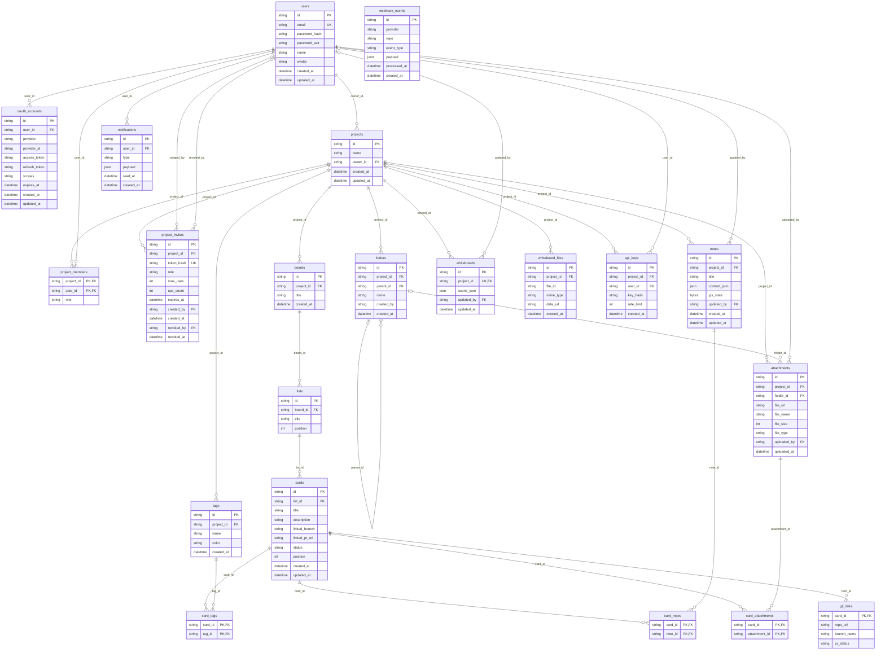

*This project has been created as part of the 42 curriculum by <login1>, <login2>, <login3>, <login4>, <login5>.*

<!-- TODO(team): replace the placeholders above with the real 42 logins of every team member (subject, chapter VI: this must stay the very first line, in italics). -->

# Transcendance

**A shared workspace for a team: a Kanban board, a whiteboard, live notes and files in one project, with the board following your Git branches on its own.**

Transcendance (the name shown in the app) is a web application for small development teams. Every project is a private workspace
with a Kanban board, an infinite whiteboard, collaborative notes and a file space. What sets it apart is the GitHub integration:
link a card to a branch and the card moves to *PR pending* when a pull request is opened and to *Done* when it is merged, without
anybody touching the board. Everything is live: what one person does appears on everybody else's screen at once.

## Contents

[Description](#description) · [Instructions](#instructions) · [Team information](#team-information) · [Project management](#project-management) ·
[Technical stack](#technical-stack) · [Database schema](#database-schema) · [Features](#features-list) · [Modules](#modules) ·
[Individual contributions](#individual-contributions) · [Resources](#resources) · [Known limitations](#known-limitations)

More detail lives in [`docs/`](docs/): [architecture](docs/architecture.md), [API](docs/api-spec.md), [database](docs/db-schema.md),
[stack](docs/tech-stack.md), [deployment](docs/deployment.md), [front-end routing](docs/frontend-routing.md).

## Description

**Goal.** Give a team one place to organise work, think and write together, instead of a task tool, a drawing tool and a note tool
that do not talk to each other, and keep the board honest by letting Git drive it.

**Key features**

- **Kanban board** with lists, cards, tags and drag and drop; every change reaches the other members live, with who is online.
- **Projects with members and roles** (viewer, member, admin), invite links, and a role-aware interface: a viewer gets a read-only board.
- **Git integration**: link a card to a GitHub branch (existing or created from the app); pull requests move the card and notify the team.
- **Whiteboard** (Excalidraw) and **notes** (rich text) edited by several people at the same time.
- **Files** in folders, attachable to cards.
- **Notifications** for every creation, update and deletion in a project, delivered live.
- **Search** across cards, notes and files.
- **Public REST API** with API keys, rate limiting and generated documentation.
- Email + password accounts, and "Continue with GitHub".

The interface is in French; this README and the code are in English.

## Instructions

### Prerequisites

- **Docker** with the Compose plugin (or Podman with a compatible `docker` command)
- **Bash** and **OpenSSL** on the host
- Free ports **8080** and **8443** (configurable)

Node.js, PostgreSQL and every dependency live in the containers: nothing else to install.

### Run it

```bash
git clone <repository-url> && cd ft_transcendence
./transcendence start
```

That is the single command. On a fresh clone it creates `.env` from `.env.example` (`.env` is git-ignored), generates the
encryption key and a self-signed certificate, builds the images (only what changed since the last build), starts the four containers
(`nginx`, `backend`, `db`, `frontend`) and applies the database migrations. Then open:

- **https://localhost:8443/**: the app (accept the browser warning, the certificate is self-signed)
- https://localhost:8443/api/health: should answer `"status":"ok"`
- https://localhost:8443/api-docs: the public API documentation (`/api/docs` redirects to it)
- http://localhost:8080/: redirects to https

Other commands: `./transcendence stop`, `restart`, `reload` (rebuild the front end only), `oauth` (GitHub credentials), `clean`, and
`--no-cache`. A plain `docker compose up` is not enough on a fresh clone (it needs the `.env`, the key and the certificate the script prepares).

### Configuration

All settings are in `.env`, copied from [`.env.example`](.env.example), which documents each variable. The ones to know:

| Variable | Purpose |
|---|---|
| `HTTP_PORT`, `HTTPS_PORT` | Ports of the reverse proxy (8080 / 8443) |
| `POSTGRES_*` | Database name and credentials (the `db` container) |
| `JWT_SECRET`, `GIT_WEBHOOK_SECRET` | Secrets (`change_me` is fine locally; use random values elsewhere) |
| `OAUTH_TOKEN_ENCRYPTION_KEY` | 64 hex characters, encrypts GitHub tokens in the database (generated for you) |
| `GITHUB_CLIENT_ID`, `GITHUB_CLIENT_SECRET`, `GITHUB_OAUTH_REDIRECT_URI` | GitHub OAuth app, for "Continue with GitHub" and the Git integration |
| `WEBHOOK_PUBLIC_URL` | Public https address of the app, so GitHub webhooks are registered automatically (leave empty on localhost) |

Without GitHub credentials, `./transcendence start` uses random placeholders: email and password work, GitHub login does not. To enable it,
create an OAuth App on <https://github.com/settings/developers> whose callback URL is `GITHUB_OAUTH_REDIRECT_URI`
(default `https://localhost:8443/api/auth/oauth/github/callback`), then run `./transcendence oauth`. Details, troubleshooting and the HTTPS
setup are in [`docs/deployment.md`](docs/deployment.md).

### Tests

```bash
cd backend && npm ci && npm test
```

Eleven end-to-end suites (about 230 checks, around four minutes) run against the real application and a throwaway PostgreSQL started in Docker (removed at the end, your data is never
touched): signed GitHub webhooks, OAuth against a stubbed GitHub, permissions over every project route and on open sockets, notifications, the public API, real time, notes edited by
several people, and concurrent requests. `npm test -- notifications oauth` runs only some of them; `npm run test:types` type-checks them. See [`backend/tests/`](backend/tests/).

### Start over

`./transcendence stop && docker compose down -v` deletes the containers **and all the data**; the next `./transcendence start` begins from nothing.

## Team information

<!-- TODO(team): one entry per member listed at the top, with the assigned role(s) (Product Owner, Project Manager / Scrum Master,
     Technical Lead / Architect, Developer) and a short description of their responsibilities. A role must be documented here for
     every member (subject, section II.1.1). -->

| Member | Role(s) | Responsibilities |
|---|---|---|
| <login1> | <!-- TODO --> | <!-- TODO --> |
| <login2> | <!-- TODO --> | <!-- TODO --> |
| <login3> | <!-- TODO --> | <!-- TODO --> |
| <login4> | <!-- TODO --> | <!-- TODO --> |
| <login5> | <!-- TODO --> | <!-- TODO --> |

## Project management

<!-- TODO(team): how the work was organised (task distribution, meetings and their rhythm), the tools used (GitHub Issues, project board,
     pull requests and reviews, see docs/github-workflow.md), and the communication channel (Discord, Slack, ...). Be honest: the
     evaluators ask how roles were distributed and how the team coordinated. -->

Git workflow: feature branches merged through pull requests into `dev`, then `main` (see [`docs/github-workflow.md`](docs/github-workflow.md)).

## Technical stack

| Layer | Choice | Version |
|---|---|---|
| Backend framework | **Fastify** (TypeScript, Node.js 22) | 5.12 |
| Real time | **Socket.IO** | 4.8 |
| Database | **PostgreSQL** | 16 |
| ORM | **Prisma** | 5.22 |
| Frontend framework | **Svelte** (runes) + **Vite**, TypeScript | 5.57 / 8 |
| Whiteboard | **Excalidraw** inside a small React island | 0.17 / React 18 |
| Notes | **Tiptap** + **Yjs** (live collaboration) | 3.x / 13.6 |
| GitHub | **Octokit** (API) and signed webhooks | 5 |
| Auth | Salted password hashes, **JWT**, **GitHub OAuth 2.0** | |
| Infrastructure | **Docker Compose**, **nginx** 1.27 (HTTPS), self-signed certificate | |
| Styling | A custom design system (CSS variables, light and dark themes) | |

**Why these choices** (the full reasoning is in [`docs/tech-stack.md`](docs/tech-stack.md))

- **Fastify** is a real framework, not a bare HTTP layer: plugins with encapsulation (one per module), routing with constraints, hook
  chains (`requireAuth`, `requireRole`, API key and rate limit), JSON-schema validation, and the official `@fastify/*` plugins for security
  headers, CORS, rate limiting and uploads. We chose it over Express for typed requests and built-in validation, and over NestJS because we did not
  need dependency injection on top.
- **TypeScript end to end** (strict mode) so the API, the database types and the interface share one language.
- **PostgreSQL + Prisma** for a typed schema with explicit relations, versioned migrations applied at start-up, and transactions whose
  isolation level we control (we rely on `Serializable` transactions for concurrent writes).
- **Svelte** for a board with drag and drop, live updates from other users, optimistic actions and a read-only mode per role, which would have been hard to keep
  consistent in hand-written DOM code. State lives in reactive class stores (for instance `kanban/boardStore.svelte.ts`). It is a multi-page
  application: every screen is a Vite entry and nginx maps the clean URLs to them; there is no client-side router.
- **React only where it is imposed**: Excalidraw ships as a React component, so the whiteboard page mounts a small React tree. Nothing else uses React.
- **Socket.IO** for the live layer: rooms per project, automatic reconnection, and a hub that shares the backend's HTTP server.
- **Yjs** for the notes, because merging several people typing in the same paragraph needs a conflict-free data type, not a "last save wins".
- **Docker Compose + nginx**: one command starts everything, and nginx is the only way in (HTTPS, security headers, a strict
  Content-Security-Policy, proxy of `/api/` and `/socket.io/`).

All connections from a browser, a script or an external service use HTTPS (`http://` answers `308`; WebSockets are `wss://`; the GitHub callback is https).
Traffic between containers is plain, on a private Docker network that is not published on the host, which the subject allows.

## Database schema

PostgreSQL, 21 tables, managed with Prisma (`backend/prisma/schema.prisma`), 9 migrations applied automatically at start-up and checked identical to the schema.
The diagram shows every table and foreign key (PK primary key, FK foreign key, UK unique); `project_members`, `card_tags`, `card_notes` and
`card_attachments` are join tables with a composite primary key. The tables, their columns, the relations and their delete rules are described in
[`docs/db-schema.md`](docs/db-schema.md).



Design points worth knowing:

- `project_members.role` is the **single source of truth for authorization**. An invite link, a token or a socket never grants access by itself.
- Secrets are never stored in clear: passwords are salted hashes, API keys and invite tokens are hashed, GitHub tokens are encrypted (AES-256-GCM).
- Notes keep their live (Yjs) state and a derived JSON copy used for search; the whiteboard keeps one Excalidraw scene per project.

## Features list

<!-- TODO(team): fill the "Developed by" column with the member(s) who worked on each feature (the git history and the pull requests
     show it: `git log --format='%an' -- <path> | sort | uniq -c`). -->

| Feature | What it does | Developed by |
|---|---|---|
| Sign up and log in | Email and password (salted hash), JWT sessions, GitHub OAuth; the display name can be edited, the account deleted | <!-- TODO --> |
| Projects | Create, rename, delete; owner and ownership transfer; list of "my projects" | <!-- TODO --> |
| Members and invitations | Add and remove members, change roles, invite links with expiry and maximum uses, revocable | <!-- TODO --> |
| Roles and permissions | viewer / member / admin enforced by the API, the live connections and the interface | <!-- TODO --> |
| Kanban board | Lists, cards, tags, drag and drop, filters, undo of a deletion, card detail, linked documents | <!-- TODO --> |
| Live board | Every change is broadcast; who is online; offline banner and automatic resynchronisation | <!-- TODO --> |
| Git integration | Link a card to a branch (create it on GitHub if needed); a pull request moves the card; audit log of webhooks | <!-- TODO --> |
| Whiteboard | Excalidraw, drawn live by several people, autosaved, shared images | <!-- TODO --> |
| Notes | Rich text edited live by several people with cursors, linkable to cards | <!-- TODO --> |
| Files | Folders, upload (type and size checked on both sides), download, attach to cards, delete | <!-- TODO --> |
| Notifications | Bell with unread counter, live delivery, mark as read | <!-- TODO --> |
| Search | One search box over cards, notes and files of a project | <!-- TODO --> |
| Public API | `X-API-Key` authentication, per-key rate limit, 5 endpoints, served documentation (`/api/docs`) | <!-- TODO --> |
| Legal pages | Privacy Policy and Terms of Service, linked from the landing page, the sign-in and sign-up pages and the account settings | <!-- TODO --> |
| Deployment | One command, HTTPS, migrations at start-up | <!-- TODO --> |

## Modules

The target is **18 points** (the minimum is 14): **6 Major (12 points)** and **6 Minor (6 points)**. Four points above the minimum leave a margin if a module is not validated.

| # | Module | Type | Points |
|---|---|---|---|
| 1 | Use a framework for both frontend and backend (Fastify + Svelte) | Major | 2 |
| 2 | Real-time features with WebSockets | Major | 2 |
| 3 | An organization system | Major | 2 |
| 4 | Advanced permissions system | Major | 2 |
| 5 | A public API with API key, rate limiting, documentation and 5+ endpoints | Major | 2 |
| 6 | **Custom module: Git and webhook integration** | Major | 2 |
| 7 | Use an ORM for the database (Prisma) | Minor | 1 |
| 8 | Remote authentication with OAuth 2.0 (GitHub) | Minor | 1 |
| 9 | File upload and management | Minor | 1 |
| 10 | Complete notification system | Minor | 1 |
| 11 | Advanced search | Minor | 1 |
| 12 | Real-time collaborative features (whiteboard and notes) | Minor | 1 |
| | **Total** | | **18** |

### 1. Framework for frontend and backend (Major, 2 pts)

*Why:* a collaboration tool is mostly structure (many routes, many screens, shared state); frameworks pay off at this size.
*How:* Fastify 5 on the backend (plugins per module, hook chains, schema validation, `@fastify/*` ecosystem) and Svelte 5 on the frontend (59 components, reactive stores). See [Technical stack](#technical-stack).
*Team:* <!-- TODO(team): member(s) -->

### 2. Real-time features with WebSockets (Major, 2 pts)

*Why:* a shared board is only useful if it is the same for everybody, right now. *Requirements:* updates across clients, graceful connection and disconnection, efficient broadcasting.
*How:* a Socket.IO hub on the backend's HTTP server, authenticated with the session JWT; every mutation of cards, lists, tags and boards is broadcast to the project room
(`card_created`, `card_moved` carrying the new order of both lists, and so on) by the services themselves, so changes made through the public API or by a GitHub webhook reach the
room like any other. Presence is per person, not per tab. Membership is live too: a role change, a rename, a removal (the person is evicted from every room of the project) and a deletion are
broadcast. A dropped connection reconnects by itself, joins its room again and refetches the project; an offline banner shows meanwhile. Room names and rules: [`docs/architecture.md`](docs/architecture.md), section 6.
*Team:* <!-- TODO(team): member(s) -->

### 3. Organization system (Major, 2 pts)

*Why:* teams need separate workspaces with their own people. In this app a **project** is the organization.
*How:* create, rename and delete projects; add and remove members, directly or through **invite links** (hashed token, maximum uses, expiry, revocation, a dedicated rate limit on joining); ownership
transfer; deleting an account hands shared projects over first. Everything a member sees or does is scoped to the project, and the interface has a settings area for it.
<!-- TODO(B): confirm the project settings screens (rename, delete, members, invitations) are complete before submission. -->
*Team:* <!-- TODO(team): member(s) -->

### 4. Advanced permissions system (Major, 2 pts)

*Why:* people in a project do not all have the same rights. *Requirements:* user CRUD, roles, different views and actions per role.
*How:* three roles per project (`viewer` < `member` < `admin`, plus the owner), stored in `project_members` and checked on every route (`requireRole`). A permission matrix test over the project routes
(123 calls below the minimum role all answered 403, and every route tested answers 401 without a token) backs it. Users: read and edit your own profile, see the profile of people you share a project with, delete your own account
(with a handover of shared projects); admins manage members and roles (the owner and the last admin are protected). The role also applies to **open connections** (a demoted member cannot keep editing on a live socket) and
to the interface (read-only board, notes, files and whiteboard for a viewer). The matrix is in [`docs/api-spec.md`](docs/api-spec.md).
*Team:* <!-- TODO(team): member(s) -->

### 5. Public API (Major, 2 pts)

*Why:* teams want to script their board. *Requirements:* secured API key, rate limiting, documentation, at least 5 endpoints.
*How:* `GET /api/projects`, `GET`, `POST`, `PUT`, `DELETE` on `/api/projects/{id}/cards`. Keys are issued by project admins (shown once, only the SHA-256 hash is stored), can be restricted to one project, act as their owner with that
person's role (so removing the user cuts the key), and are revocable at once. A fixed-window rate limit applies per key (`429` with `Retry-After` and `X-RateLimit-*` headers). The documentation is served by the app:
`/api-docs` (page of the site, `/api/docs` leads there) and `/api/openapi.json` (OpenAPI 3).
*Team:* <!-- TODO(team): member(s) -->

### 6. Custom module: Git and webhook integration (Major, 2 pts)

**Why we chose it.** The board is where a team says what it is doing, and Git is where the work actually happens. The two drift apart as soon as somebody forgets to move a card. This module makes Git the source of truth: it is the idea
the project is built around, and it ties the other modules together (OAuth gives the token, notifications and the live layer deliver the result, the public API shows the same cards).

**Technical challenges it addresses.**

- *Trusting an inbound call.* The receiver (`POST /api/webhooks/git`) has no user session. It verifies GitHub's HMAC-SHA256 signature over the **raw** request body with a constant-time comparison before reading anything, which needs
  the unparsed body next to the parsed one.
- *Acting for a user on GitHub.* Listing, creating and linking branches use the user's own OAuth token, stored encrypted; the app registers the repository webhook itself (`ensureRepoWebhook`) when a branch is linked, and degrades cleanly
  (link anyway, explain) when the token, the rights or the public URL are missing.
- *A small state machine that must not regress.* A card goes `todo` -> `In progress` (first push) -> `PR pending` (pull request opened or reopened) -> `Done` (merged into the **default branch**), and back to `In progress` if the pull request is closed
  without a merge. A later push never moves a card back; a merge into another branch is ignored; each transition is a single conditional `UPDATE`, so two webhooks arriving together cannot overwrite each other.
- *Matching a card without guessing.* Cards are found only through their stored repository and branch (`git_links`), never from commit messages or branch names.
- *Auditability and failure handling.* Every valid delivery is stored in `webhook_events` and stamped when processed; a processing error answers `500` and leaves the event unprocessed so GitHub can redeliver. Project admins can read the log.
- *Reaching the people.* The change is broadcast to the open boards and notified to every member.

**How it adds value.** The board stays accurate without effort, reviewers see the state of work at a glance, and a team can trust what the board says.

**Why it deserves Major status (2 points).** It is not a thin wrapper around an API: it combines a third-party OAuth integration, a cryptographically verified inbound channel, an idempotent state machine, an audit trail, automatic remote configuration, and
the real-time and notification layers, across the backend (`backend/src/modules/git/`), the database (`git_links`, `webhook_events`) and a dedicated interface (the branch dialog on every card). It is tested end to end with signed deliveries
(push, opened, reopened, merged, closed, regression guards): `backend/tests/e2e/git-webhooks.e2e.ts`.
*Team:* <!-- TODO(team): member(s) -->

### 7. ORM (Minor, 1 pt)

Every query goes through Prisma, including transactions and the `Serializable` ones used for concurrent writes. There is **no raw SQL** in the backend. 21 models with explicit relations and 9 versioned migrations that are checked identical
to the schema. See [`docs/db-schema.md`](docs/db-schema.md).
*Team:* <!-- TODO(team): member(s) -->

### 8. OAuth 2.0 (Minor, 1 pt)

"Continue with GitHub" on top of email and password. The state parameter is a signed token **bound to the browser by an HttpOnly cookie** (it prevents a login being forced onto a victim); the email used is GitHub's verified primary address (never an unverified one, so
a login cannot attach itself to someone else's account); a signed-in user can also link GitHub afterwards. The access token is encrypted at rest and is what the Git integration uses. Details: [`docs/api-spec.md`](docs/api-spec.md).
*Team:* <!-- TODO(team): member(s) -->

### 9. File upload and management (Minor, 1 pt)

Upload of images, PDF, text, Markdown, JSON and zip files up to 10 MiB, checked on the server (type and size, with the stored name unrelated to the original), organised in folders, attachable to cards, downloadable by project members only, and deletable.
<!-- TODO(B): this module also requires client-side validation, upload progress indicators and previews (subject IV.1). Update this paragraph once they are in. -->
*Team:* <!-- TODO(team): member(s) -->

### 10. Complete notification system (Minor, 1 pt)

*Requirement:* every creation, update and deletion. One dispatcher (`notifyProject`) tells the members of a project except the person who acted. It is called for cards, lists, tags, notes, files, folders, the whiteboard, the project itself, members, the public API and the GitHub automation.
Repeated updates (a note autosaving) refresh one unread notification instead of piling up. Delivery is live through each user's personal room; the bell in the header shows the unread counter and links to the relevant page. Read notifications are purged after 30 days.
*Team:* <!-- TODO(team): member(s) -->

### 11. Advanced search (Minor, 1 pt)

One search over the cards, notes and files of a project, with the text of rich notes indexed.
<!-- TODO(B): the subject requires filters, sorting and pagination. Update this paragraph once they are in. -->
*Team:* <!-- TODO(team): member(s) -->

### 12. Real-time collaborative features (Minor, 1 pt)

Shared workspaces edited live: **notes** (Tiptap + Yjs: several people type in the same paragraph, each with a named cursor, a late joiner catches up, a viewer cannot edit) and the **whiteboard** (strokes relayed over Socket.IO and merged on the server, with remote cursors). Concurrent edits converge: every client and the saved
note end identical in the tests.
<!-- TODO(B): add anything not covered once the whiteboard and notes have been tested by two browsers. -->
*Team:* <!-- TODO(team): member(s) -->

## Individual contributions

<!-- TODO(team): for each member, a detailed breakdown of what they built (features, modules, components), the challenges faced and how they were overcome, and an honest picture of
     the distribution of the work. The git history is checked by the evaluators, so it must match: `git shortlog -sn`, and the pull requests. -->

## Resources

**References**

- Fastify: <https://fastify.dev/docs/latest/>
- Prisma: <https://www.prisma.io/docs>
- PostgreSQL, transaction isolation: <https://www.postgresql.org/docs/16/transaction-iso.html>
- Socket.IO: <https://socket.io/docs/v4/>
- Svelte 5: <https://svelte.dev/docs/svelte/overview>, Vite: <https://vite.dev/guide/>
- Excalidraw: <https://docs.excalidraw.com/>, Tiptap: <https://tiptap.dev/docs>, Yjs: <https://docs.yjs.dev/>
- GitHub OAuth apps: <https://docs.github.com/en/apps/oauth-apps>, webhooks and signature validation: <https://docs.github.com/en/webhooks>, Octokit: <https://octokit.github.io/rest.js/>
- OAuth 2.0 (RFC 6749): <https://datatracker.ietf.org/doc/html/rfc6749>
- OpenAPI 3.0: <https://spec.openapis.org/oas/v3.0.3>
- Content-Security-Policy and security headers: <https://developer.mozilla.org/en-US/docs/Web/HTTP/CSP>, OWASP Cheat Sheet Series: <https://cheatsheetseries.owasp.org/>
- Docker Compose: <https://docs.docker.com/compose/>, nginx: <https://nginx.org/en/docs/>

**How AI was used**

AI assistants (Claude Code) were used as a tool, on specific tasks, and everything kept was read, tested and is explainable by the person who submitted it.

<!-- TODO(team): each member, edit and complete this part with what is true for them; the subject checks that you can explain your code. Below is what was done for the backend, Git, security and infrastructure work. -->

- **Audit and review**: reading the existing modules against the subject to list what was missing or wrong (for example the unverified-email risk in the GitHub login, the per-client rate limits that were in fact shared, the roles that were never re-checked on open connections).
- **Test writing**: end-to-end scenarios against the real application on a throwaway database (signed webhooks, OAuth with a stubbed GitHub, the permission matrix over every route, live sockets, concurrent requests). Failures were read and the causes understood before fixing.
- **Fixes and refactors** in the Git, OAuth, notifications, permissions, real-time, concurrency and deployment code, reviewed and run before being committed.
- **Documentation**: first drafts of the documents in `docs/` and of this README, then checked against the code.
- **Not delegated**: the choice of modules and of the product, the decisions on trade-offs, and the validation of every result.

## Known limitations

- The certificate is self-signed (browsers warn). A real deployment needs a real certificate and the commented HSTS header in `infra/nginx/default.conf.template`.
- GitHub cannot reach `localhost`: the repository webhook is registered automatically only when `WEBHOOK_PUBLIC_URL` is set; otherwise add it by hand to try the Git integration.
- Real-time rooms live in the memory of one backend process: the database side is safe with several instances (serializable transactions), but live delivery across instances would need a Socket.IO adapter.
- Events missed during a connection drop are not replayed: the board refetches its state when the connection returns.
- The tests cover the backend; the frontend has no automated tests (it was checked by hand in the browser).
<!-- TODO(team): add any limitation specific to your own modules. -->
